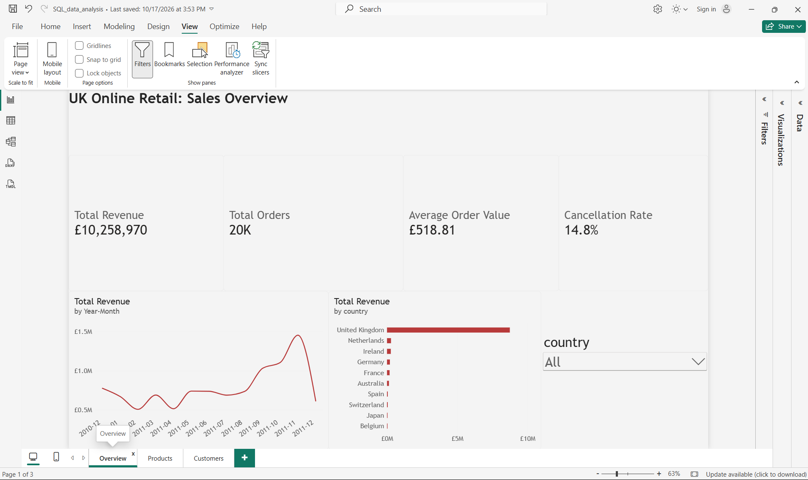
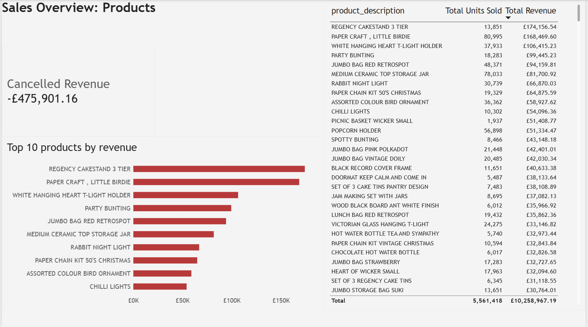
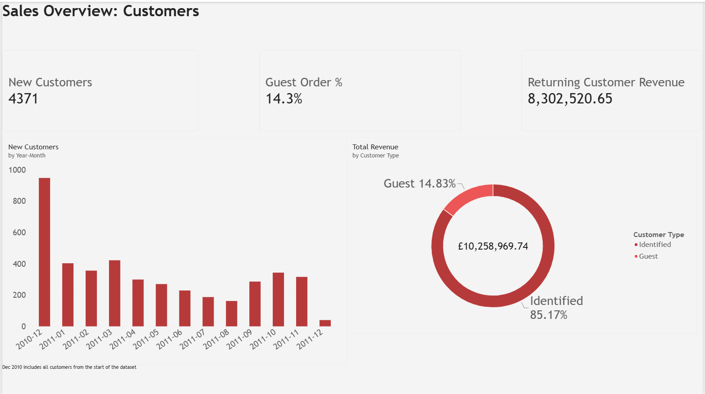

# SQL & Power BI Reporting Pipeline — UK Online Retailer

An end-to-end data pipeline that takes a real, messy transaction-level dataset from a UK online retailer and turns it into a validated star schema ready for Power BI reporting — covering data quality investigation, SQL-based cleaning, dimensional modelling, and DAX measures.

**Why this project:** built to demonstrate the exact combination a Data Analyst / BI role actually needs day to day — extracting and validating data from a messy source, designing a reporting-friendly data model, and writing the DAX that makes a dashboard trustworthy rather than just colourful.

## Dashboard preview





The Power BI report is in `powerbi/retail_dashboard.pbix`. Open it with Power BI Desktop.

## The pipeline

```
raw CSV (541,909 rows, 2010–2011)
   │  scripts/load_raw.py  (ingest + normalise date format)
   ▼
raw_online_retail            (SQLite, untouched except typed dates)
   │  sql/01_data_quality_checks.sql   (profile every issue BEFORE touching the data)
   │  sql/02_staging_clean.sql         (dedupe, flag cancellations/adjustments/guests)
   ▼
stg_online_retail            (536,641 rows, cleaned & flagged, nothing silently dropped)
   │  sql/03_star_schema.sql           (build fact + 4 dimensions)
   ▼
fact_sales + dim_date + dim_product + dim_customer + dim_country
   │  sql/04_validation_queries.sql    (row counts reconcile, zero orphan keys)
   ▼
data/star_schema/*.csv  →  Power BI (see docs/powerbi_setup_guide.md)
```

## What's in this repo

| Path | Contents |
|---|---|
| `scripts/load_raw.py` | Loads the source CSV into SQLite, normalises the date format |
| `scripts/run_sql.py` | Runs any `.sql` file against the database, prints results |
| `sql/01_data_quality_checks.sql` | Profiles every data quality issue in the raw data |
| `sql/02_staging_clean.sql` | Cleans and flags the data — dedup, cancellations, guest orders, adjustment codes, country naming |
| `sql/03_star_schema.sql` | Builds the fact table and four dimension tables |
| `sql/04_validation_queries.sql` | Post-build checks: row counts, referential integrity, revenue sanity check |
| `docs/data_quality_checklist.md` | Every issue found, its scale, how it was resolved, and why |
| `docs/data_dictionary.md` | Every table and column in the star schema |
| `docs/dax_measures.md` | DAX measures for the Power BI report, with the reasoning behind each |
| `docs/powerbi_setup_guide.md` | Step-by-step: import → relationships → date table → measures → report pages → publish |

## Key data quality findings

- **135,080 rows (~25%)** had no `CustomerID` — kept and flagged (`is_guest_order`) rather than dropped, since deleting them would understate revenue by a quarter.
- **9,288 rows** were cancellations (`InvoiceNo` starting with `C`) — flagged, not deleted, since a return is a real business event.
- **~2,900 rows** were postage/fees/adjustments (`POST`, `DOT`, `BANK CHARGES`, etc.) mixed into the product column — flagged so they don't appear as a "top-selling SKU" by volume alone.
- **5,268 duplicate rows** removed (extra copies of 5,268 repeated lines), so 541,909 − 5,268 = 536,641.
- **112 product codes** appeared twice with spellings that differ only by upper and lower case (for example '15056BL' and '15056bl'). SQLite treats these as different codes but Power BI does not, so the codes were converted to uppercase in Power Query before building the product relationship.
- **1 manual adjustment row** (code 'm', £2.55) was not caught by the adjustment flag because the SQL code list is case sensitive. It is excluded on the Products page of the Power BI report with a page filter, and making the SQL match case insensitive is planned fix.
- **38 → 36 countries** after standardising naming (`EIRE` → `Ireland`) and excluding non-country placeholders (`Unspecified`, `European Community`).

Full detail and reasoning: [`docs/data_quality_checklist.md`](docs/data_quality_checklist.md).

## Validation results

- `fact_sales` row count matches the cleaned staging table exactly: **536,641 = 536,641** — nothing lost during modelling.
- **Zero** orphaned foreign keys across all three dimension joins.
- Total valid-sale revenue: **£10,258,969.74**, ~85% from the United Kingdom — the expected result for a UK-based retailer, used here as the final sanity check.

## Reproducing this locally

```bash
pip install -r requirements.txt
python scripts/load_raw.py
python scripts/run_sql.py sql/02_staging_clean.sql
python scripts/run_sql.py sql/03_star_schema.sql
python scripts/run_sql.py sql/04_validation_queries.sql
```

This produces `data/retail.db`. Export each star-schema table to CSV for Power BI import (or query the SQLite file directly via Power BI's ODBC connector).

## Data source

[UCI Machine Learning Repository — Online Retail](https://archive.ics.uci.edu/dataset/352/online+retail): real transaction data from a UK-based online retailer selling mainly unique all-occasion gifts, December 2010 – December 2011 (541,909 rows). The raw file is not stored in this repo. Download it (a CSV copy is at https://raw.githubusercontent.com/databricks/Spark-The-Definitive-Guide/master/data/retail-data/all/online-retail-dataset.csv) and save it as `raw/online-retail-dataset.csv` before running `scripts/load_raw.py`.

## Author

Jayesh Patil — [LinkedIn](https://www.linkedin.com/in/jayeshdeepak-patil) · [email](mailto:jayesh41297@gmail.com)
